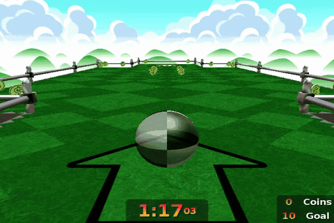
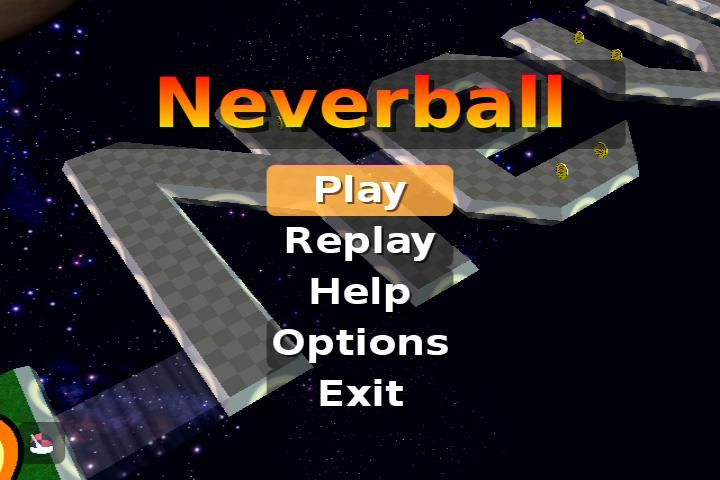

# neverball-nxdk

> **64 MB (64 MiB) Xbox support is expected, but has not been verified on a stock console.**
> The developer's Xbox has **128 MB RAM**. Tests use its verified **64 MiB runtime limit**; this is evidence for compatibility, not a stock-hardware guarantee.

**[Download the full game — v0.2.0-alpha.2 (Xbox ZIP)](https://github.com/ZacharyLeahan/neverball-nxdk/releases/download/v0.2.0-alpha.2/neverball-nxdk-v0.2.0-alpha.2-xbox-128mb.zip)**
· [Release notes, standalone XBE, source and checksums](https://github.com/ZacharyLeahan/neverball-nxdk/releases/tag/v0.2.0-alpha.2)

The full ZIP includes the tested portal-stars fix and all required game files.
Extract the complete folder to your Xbox HDD and launch `default.xbe`; keep
`Neverball/` and `licenses/` beside it. The standalone XBE alone is insufficient.

*Neverball gameplay on the physical Xbox, captured through ESP KVM. The GIF
is silent and reduced in size/frame rate for the README.*

Xbox title screen

Tilt the  floor to roll a  ball through an obstacle  course within the
given  time.  If  the  ball falls  or time  expires, a ball is lost.

Collect coins to unlock the exit  and earn extra balls.  Red coins are
worth 5.  Blue coins are worth 10.  A ball is awarded for 100 coins.

## Original Xbox development

The modern game runs on a physical **128 MiB original Xbox** using NXDK and
[Ryzee119's nxdk-gles11](https://github.com/Ryzee119/nxdk-gles11). Local hardware testing confirmed playable Easy level 3,
correct coin rendering, responsive controls, music and effects. Automatic title
replay and repeated restarts were also observed. **Stock 64 MiB hardware remains unverified; see the RAM notes below.**
Easy 3 access in the isolated test installation uses a backed-up test unlock;
this is not a claim of earned progression or level completion.

See [build and port notes](doc/nxdk.md) and the
[physical hardware ledger](doc/hardware-testing.md) for commands, dependency
pins, exact tested XBE hashes and remaining limitations.

Xbox **Exit** offers confirmed launcher return, game restart,
console reboot and power off, with Cancel selected by default. See the
[system-menu notes](doc/xbox-exit-menu.md) for configuration and test coverage.

This Xbox continuation builds on [JayFoxRox / Jannik Vogel's original NXDK
port](https://github.com/JayFoxRox/neverball/tree/xbox). The modern game retains
upstream Neverball history, content and contributor credits, and
uses [Ryzee119's nxdk-gles11](https://github.com/Ryzee119/nxdk-gles11) renderer.

### Rendering with nxdk-gles11

**This Xbox port builds and links [Ryzee119's nxdk-gles11](https://github.com/Ryzee119/nxdk-gles11)
as its active graphics backend.** It is a runtime dependency compiled into the
XBE. Ryzee119 deserves credit for the GLES implementation that makes this
rendering path possible.

Neverball already has an OpenGL ES rendering path. We compile that path with
`ENABLE_OPENGLES=1`; nxdk-gles11 implements its GLES calls for the original
Xbox's NV2A GPU through NXDK/pbkit:

**Neverball's GLES renderer → nxdk-gles11 → NXDK/pbkit → Xbox NV2A GPU**

This lets the modern game reuse its existing rendering code for level geometry,
textures, lighting, fog, vertex buffers, shadows and particle effects on Xbox.
The backend also supplies the graphics-context and frame-presentation hooks
used by the Xbox platform code. Together, these enable the modern levels,
ball and coin rendering, title replay visuals, and portal effects seen in our
physical hardware tests. Controller input, audio and the Xbox system menu are
handled by the game's separate platform integration.

The integration is concrete and reproducible:

* [Renderer bootstrap](scripts/bootstrap-xbox-renderer.py) fetches the pinned
  nxdk-gles11 revision `0cf17fa709f42158d11a1571f87705b692699bd3`.
* [Xbox CMake configuration](xbox/CMakeLists.txt) compiles the renderer, and
  [Makefile.nxdk](Makefile.nxdk) links `GLESv1_CM`, `swizzle` and `arena` into the
  game alongside pbkit. We use GLES directly; the optional gl4es layer is disabled.
* [Xbox platform code](xbox/platform.c) calls its `glContextInit` and `glFlipNV2A`
  hooks to initialize graphics and present frames.
* [The portal-particle fix](https://github.com/ZacharyLeahan/neverball-nxdk/issues/6)
  adapts Neverball's base-texture assignment to the backend's NV2A point-sprite
  requirement: texture unit 3. Goal stars and teleporter sparkles were then
  verified on the physical Xbox; before/after captures are in the issue.

See the [port notes](doc/nxdk.md) for backend constraints, dependency attribution
and build instructions. Renderer support alone does not establish RAM
compatibility; see the capped hardware tests below.

### 64 MB compatibility: expected, not yet confirmed on stock hardware

The developer's physical Xbox has **128 MiB installed**, but the XBE already
sets `Limit64Megabytes`. An A/B test changing only that header bit showed
**63.875 MiB less available memory with the limit enabled**. The kernel still
reports 128 MiB installed; that is not the game's effective allocation budget.

Title/replay, Easy 3 gameplay, restart/menu transitions and the large Confetti
level have run under this cap. The extended run retained about **34.4 MiB
minimum sampled free RAM**. Samples do not measure every transient peak.
This makes stock 64 MB operation a reasonable expectation, but **we have not
tested an actual 64 MB console or every level**.

There is also a known [Adventure GPU DMA failure](https://github.com/ZacharyLeahan/neverball-nxdk/issues/10)
that reproduces **with and without** the cap. It is not specific to 64 MB
operation and remains unresolved. This is an experimental port, not a claim
of complete compatibility or stability.

See the [64 MiB validation issue](https://github.com/ZacharyLeahan/neverball-nxdk/issues/1)
and [hardware ledger](doc/hardware-testing.md) for exact test coverage,
XBE hashes and remaining checks. Reports from stock 64 MB Xbox owners are welcome.

### Source and reference repositories

* [This modern continuation](https://github.com/ZacharyLeahan/neverball-nxdk).
* [Original Neverball upstream](https://github.com/Neverball/neverball) and
  [Neverball contributors](doc/authors.txt): game, engine, levels and assets.
* [JayFoxRox / Jannik Vogel's original Xbox port](https://github.com/JayFoxRox/neverball/tree/xbox):
  original Xbox/NXDK port authorship and the foundation of this continuation.
* [Ryzee119/nxdk-gles11](https://github.com/Ryzee119/nxdk-gles11): the direct
  OpenGL ES renderer used by this migration.
* [XboxDev/NXDK](https://github.com/XboxDev/nxdk): toolchain, runtime and pbkit.
* [ESP KVM Xbox project](https://github.com/ZacharyLeahan/espkvm-xbox): physical
  video/audio capture and remote controller testing.

Inherited code retains its original notices; adaptations and source commits
are credited in the port notes. Dependency notices remain with their sources.

## Release Notes

Release highlights can be found in [doc/release-notes.md](doc/release-notes.md).

## Documentation

* [LICENSE.md](LICENSE.md): a description of licensing and exceptions
* [doc/install.txt](doc/install.txt): instructions on how to build the
  game from source code
* [doc/manual.txt](doc/manual.txt): a detailed description of how to
  play and configure the game
* [doc/authors.txt](doc/authors.txt): a list of people who have
  contributed to Neverball

## Resources

* [Website](https://neverball.org/)
* [Development](http://github.com/Neverball)
* [Discord](https://discord.gg/HhMfr4N6H6)

## Translation

Neverball uses the gettext approach to translations. We're always
interested in covering more languages. Join the
[Neverball project on Transifex](https://www.transifex.com/neverball/neverball/).
