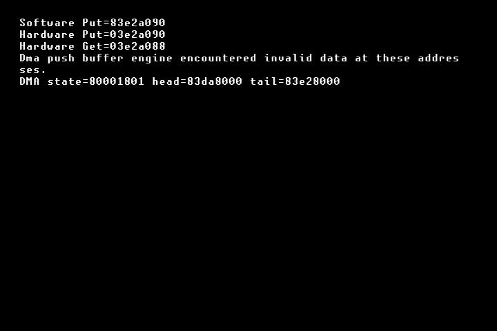
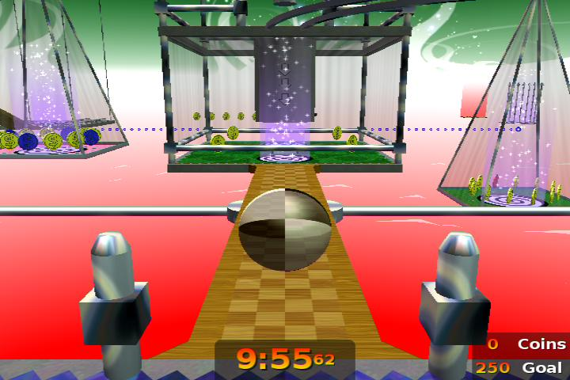
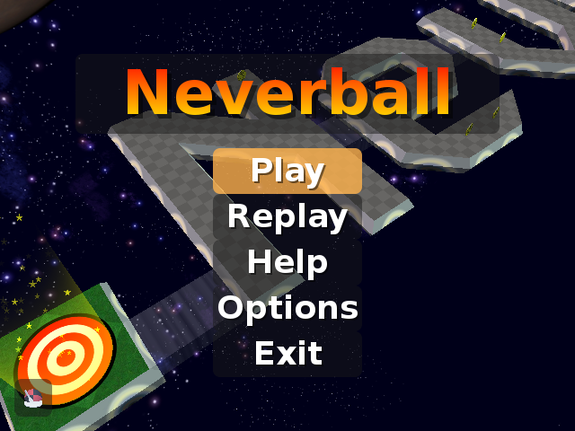
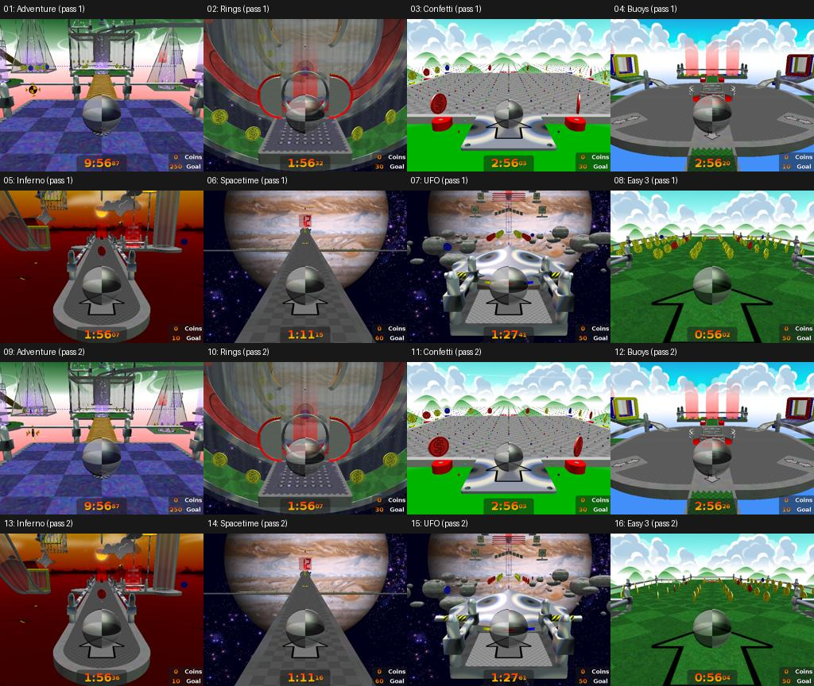
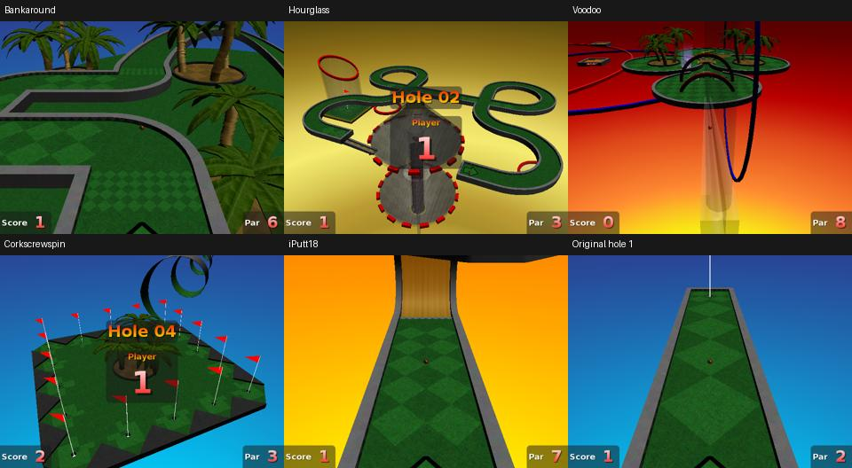

<!-- Generated by Codex CLI 0.144.6 (GPT-6). -->
# Modern upstream Xbox hardware ledger

## First full-game candidate, 2026-10-20

XBE SHA-256:
`c1453c80f82f2844d3cfaae443d04c41c0b0d6055a1ad501e1c1c6e7c67842c6`.

Upstream base `0387f91e`, branch `codex/nxdk-gles11`, local migration changes.
Renderer `0cf17fa709f42158d11a1571f87705b692699bd3`, direct GLES.
Patched SDK copied locally from the accepted older-port SDK; clean rebuild
reproducibility is outstanding. Overlay disabled; recovery timeout 60 seconds.

Host verification: full NXDK link/XBE generation, 429 modern levels compiled,
51 native 48 kHz stereo audio sources staged, desktop unit tests passed,
real Ogg mixer and bounded retry sanitizer tests passed. Initial backend build
exposed Apple archive index incompatibility; final link uses LLVM archives.

Deployment destination: `/F/neverball-upstream`. `/F/neverball-nxdk` protected.
Prelaunch FTP reported the XBMC dashboard. KVM prelaunch stream retained one
frame showing XBMC; one static frame does not establish continuous freshness.
Runtime acceptance is pending launch and physical testing. No emulator used.

This candidate does not establish 64 MiB compatibility, save persistence,
menu/gameplay/audio/replay acceptance, or repeated-transition stability.


### First launch: black screen, recovery not established

All 1,514 staged files passed FTP read-back verification. Manifest:
`build/hardware/20261020T121336Z/deploy.json`.
Launch rechecked the manifest before issuing
`SITE RunXBE F:\neverball-upstream\default.xbe`.
FTP timed out at launch; this is consistent with dashboard shutdown but is
not proof of successful initialization.

`build/hardware/first-launch.jpg` retained two MJPEG frames; the last was
black. A bounded recording is `VIDEO/up-042278.ts`, retained locally at
`build/hardware/first-boot-recording/up-042278.ts` (60.053333 seconds,
1280x720 H.264 and AAC). Recorder reported 1,157 video frames, zero video/audio
drops, and 950 inserted silence frames. These capture statistics do not
establish game/audio progress. Original KVM `vid_codec=0` was restored after
the recording, using a finally block.

Dashboard FTP did not return within a bounded 60-second probe. The watchdog
has not established recovery, and the freeze location is unknown. Requested
human dashboard return/reboot and physical-screen confirmation to retrieve
`log.txt` and `stderr.txt`. No menu/gameplay acceptance claimed.


A follow-up diagnostic candidate is built locally but not deployed:
`b5fd6c8ac9d741cb9a9dee7b91c8fc507e23531dce314f18f4a46aa92df377e2`.
It adds stdout markers around configuration, package, input, audio, video and
preload initialization. The original deployed XBE is retained under
`build/candidates/first-boot/default.xbe`. Retrieve the original startup logs
before replacing it. The build now invokes CMake through Makefile.nxdk and
prevents NXDK's generic .lib rule from trying to rebuild CMake output archives.


### Logs retrieved after manual dashboard return

User confirmed XBMC was loaded; physical black-screen observation remained
unknown. Retrieved `build/hardware/20261020T122501Z/log.txt` and `stderr.txt`.
The XBE entered main and logged data/write directory discovery, followed by
`Failure to open neverball.log`. No renderer initialization was logged.

Diagnostic XBE `b5fd6c8ac9d741cb9a9dee7b91c8fc507e23531dce314f18f4a46aa92df377e2`
was uploaded/read-back verified in manifest
`build/hardware/20261020T122524Z/deploy.json` and launched. Its subsequent
capture was retained as `build/hardware/diagnostic-launch.jpg`; dashboard FTP
again did not return within a bounded wait. Requested another dashboard return
for diagnostic logs. The watchdog remains unqualified.

Code inspection found two concrete integration defects. SDL's Xbox VideoInit
calls pixelFormatSelector(XVideoGetMode().bpp); NXDK initializes the mode to
all zeros and pixelFormatSelector asserts for bpp=0. The port had deferred
XVideoSetMode until after SDL_Init. The next candidate establishes video mode
before SDL initializes. Separately, modern path_join returns forward slashes,
while NXDK's CreateFile/FindFirstFile expect native backslashes. The next
candidate converts allocated paths at filesystem boundaries while retaining
forward slashes for virtual/ZIP paths. This addresses log/config/asset paths
without changing desktop paths or ZIP entry naming. Runtime confirmation is
pending the next deployment.

Prepared candidate SHA-256:
`8b92b320791d87d5cc1af6d9c8a9a777ba70b5282fbd0c9ead5006b7f3eceb42`.
The full NXDK build and desktop unit tests passed. Native path checks ran on
host with address/undefined-behavior sanitizers. No emulator or desktop game
was run.


### Corrected startup reaches title

After the user returned to XBMC, diagnostic logs were retrieved to
`build/hardware/20261020T123703Z/`. The last marker was
`startup: make_dirs_and_migrate`; the build had no marker immediately before
SDL_Init, so the marker alone does not distinguish directory setup from SDL.
The source-level SDL zero-bpp assertion and path incompatibility were fixed.

Candidate `8b92b320791d87d5cc1af6d9c8a9a777ba70b5282fbd0c9ead5006b7f3eceb42`
was uploaded/read-back verified in
`build/hardware/20261020T123716Z/deploy.json` and launched from the separate
installation. `build/hardware/native-path-launch.jpg` retained three MJPEG
frames and shows the title menu with textured background/planet and coins.
This establishes reaching title, not yet controller/audio/gameplay acceptance.

The user connected the ESP controller and explicitly requested agent-driven
testing. Remote A was sent for 150 ms and released. The KVM MJPEG endpoint
returned HTTP 409 while H.264 recording was active; this is a capture-mode
constraint, not evidence of a game freeze. Inspect after restoring MJPEG.


ESP A selected Play and Neverball Easy. Captures `esp-play.jpg` and
`easy-select.jpg` establish menu response. Easy 3 was locked in the fresh save;
right input could not select it and the attempted launch entered Easy 1.
This was progression behavior, not demonstrated D-pad failure.

Easy 1 reached the introduction and playable scene. Bounded ESP left-stick
inputs moved the ball forward and laterally, with a changing camera/ball view.
Captures: `easy1-input.jpg`, `easy1-movement.jpg`, `easy1-coins.jpg`,
`easy1-left.jpg`. Coins appear fully above the floor in these scenes; no
collection was established in this first run (counter remained zero).
After its normal timeout, the Time's Up scene appeared; three bounded B inputs
returned through menus to the title (`return-title.jpg`) without freezing.

Working-title/menu recording: `VIDEO/up-043422.ts`, local
`build/hardware/native-path-gameplay/up-043422.ts`. Recorder reported 1,367
video frames, zero video/audio drops and 508 inserted silence frames. Decoded
captured audio had no zero-RMS one-second interval (RMS range 988.4..3287.4 in
signed 16-bit units). This supports continuity, not subjective quality.
Capture codec was restored to the prior setting after recording.

For targeted Easy 3 testing, `scripts/prepare-xbox-test-level.py` backs up the
isolated test save and appends an unlocked-only V2 entry for
`map-easy/coins.sol`, using a mismatched version to retain score/completion
values. This is a reversible fixture, not earned progression. It touches only
`/F/neverball-upstream/Neverball/Scores/easy.txt` and verifies readback.


### Automatic title replay cycle

Recording `VIDEO/up-043771.ts`, retained as
`build/hardware/automatic-replay/up-043771.ts`, lasts 60.053333 seconds.
Frames extracted at 10 and 50 seconds show Easy 1 gameplay replay behind the
title menu, with different ball/coin views. A later live MJPEG capture
`replay-later.jpg` shows the animated title background again. Together with
`return-title.jpg`, this establishes title → saved replay → title on hardware
for this candidate. This does not qualify arbitrary replay files.

Recorder reported 1,465 video frames, zero video/audio drops, and 595 inserted
silence frames. Original capture codec restored. The user's physical screen
and subjective audio quality have not been confirmed during this run.


### Menu Exit and first memory/audio log collection

ESP B from title exercised menu Exit. Live capture `menu-exit.jpg` showed XBMC,
and FTP returned without a human reboot. Logs retained at
`build/hardware/20261020T124710Z/` include frame 30,600 and 102 sampled memory
readings. Sampled free physical RAM ranged 40.10..42.10 MiB on the 128 MiB
console; these samples do not measure transient allocation peaks. No 64 MiB
qualification follows. Shutdown audio counters: 24,545 callbacks, 47 EOFs,
zero decode errors and zero seek errors.

The first test-save upload was rejected by the dashboard FTP server because
STOR used an absolute path from its root. The helper now changes into the
exact candidate Scores directory before STOR. The command sequence also
requires fixture success before launch. The rejected upload did not change
the test save; an unchanged XBE relaunch was exited before retrying.


The corrected fixture helper uploaded and read-back verified the unlocked-only
Easy 3 entry. Backup and exact fixture evidence:
`build/hardware/20261020T125037Z-fixture/`. The same tested XBE was relaunched;
no executable, level geometry, physics, coin values or collision change was
made to bypass progression.


### Easy 3 gameplay and repeated restart qualification

The menu selected level 03 (`easy3-selected.jpg`) and its introduction loaded
(`easy3-intro.jpg`). ESP A began gameplay, followed by bounded forward/lateral
left-stick inputs. Recording `VIDEO/up-044272.ts`, local
`build/hardware/easy3-gameplay/up-044272.ts`, shows controller-driven motion,
coin collection (9 on the HUD at frame10.png), collection particles, and fully
visible gold/red/blue coins. Blue 10-value coins are intentional. No level
completion is claimed; progression access used the documented test fixture.

The 30-second recording reported 694 video frames, zero video/audio drops,
and 622 inserted silence frames. Captured audio was nonzero during the active
run (seconds 0..16), faded at second 17, then was silent while paused. This
matches `pause_enter` intentionally fading music out over one second; it is
not evidence of a gameplay audio stall. The codec was restored afterward.

Three pause/Restart input sequences were exercised. The first capture shows
the restart transition; after the subsequent two sequences,
`easy3-restart3.jpg` shows fresh coins, coin count 0 and a running 57-second
clock. No freeze was observed through these sequences. A subsequent 4.98-second
48 kHz raw audio observation (`easy3-restart-audio.wav`) reported
`rms=0.0584294`, `active_frames=237315/239040`, establishing resumed captured
sound. Subjective sound quality and individual effects remain unconfirmed by
a physical listener.

After the return-control sequence the live capture showed XBMC. Final logs
retrieved to `build/hardware/20261020T125823Z/` contain normal audio/joystick
shutdown records: 17,608 audio callbacks, 60 EOFs, zero decoder errors and zero
seek errors. They reached frame 21,900; 73 RAM samples ranged 40.42..41.53 MiB
free on the 128 MiB console. Sampling does not measure transient peaks.
The exact intermediate Give Up/confirmation path was not captured, so only
the resulting dashboard return and orderly shutdown are qualified.

The console is left at XBMC. The separate modern installation retains its
backed-up, unlocked-only Easy-3 fixture. The known-good older installation was
not modified. All runtime results in the successful runs above refer to XBE
`8b92b320791d87d5cc1af6d9c8a9a777ba70b5282fbd0c9ead5006b7f3eceb42`.

Remaining: clean SDK/binary reproducibility; standard 64 MiB hardware support;
subjective AV quality/latency feedback; longer and broader level/replay stress;
full license/distribution audit; general save persistence and disc installs;
watchdog recovery under failures. No release published or master merged.


### Physical local acceptance — 2026-10-20

The same verified XBE was launched from `/F/neverball-upstream` for the user's
local test. Fresh capture `build/hardware/local-test-launch.jpg` showed the
modern title scene. The user subsequently confirmed: “Works great locally”,
with Easy 3 playable, coins looking right, and controls, music and effects all
working. This provides physical local acceptance of those checks on the
128 MiB console and supersedes the pending subjective AV confirmation above.
It does not establish extended stability, a latency measurement, stock 64 MiB
support, or a completed Easy-3 run. The Easy-3 test unlock remains documented.
The game was left running for the user's test; the earlier XBMC state is historical.

Accepted XBE SHA-256:
`8b92b320791d87d5cc1af6d9c8a9a777ba70b5282fbd0c9ead5006b7f3eceb42`.

The user requested committing and pushing the migration branch. No release
publication or merge to master was requested.


## Xbox Exit / System menu — 2026-10-20

Branch `codex/xbox-exit-menu` layers the Slime Volley system-menu pattern onto
modern Neverball's native GUI. Reference: slimevolley-nxdk commit
`65c86911fe5ab199e7853886af7c71d8ad1e5085`, `ports/nxdk/Platform.c`.
No older-port, dashboard or boot configuration files were modified.

The launcher at `/E/Dashboard/default.xbe` matched XBMC's `/Q/default.xbe` by
full readback SHA-256:
`2cbfeeb3e888e8df74316b33ea0ab056c2ea401ad09032507fed06a59fd9bbbe`.

First candidate XBE:
`179112e4021556b03cea09aa46740cd223d51a4f7752a7437e798e9b8a806fb9`.
Deployment/readback manifest: `build/hardware/20261020T135246Z/deploy.json`.
The menu opened with Cancel selected (`exit-menu.jpg`). Cancel returned to
title, and the launcher confirmation also selected Cancel initially
(`launcher-confirm.jpg`). Confirming Return to launcher reached dashboard FTP;
logs in `build/hardware/20261020T135553Z/` record action 0, normal audio cleanup
(zero decode/seek errors), and cleanup-complete target `E:\Dashboard\default.xbe`.

The initial Restart game preflight rejected the native current-XBE path with
DOS attribute error 123; the error screen kept the game running
(`restart-confirm-cancel.jpg`). The correction uses a rootless NT file open
as in NXDK's hal/xbox.c before invoking XLaunchXBE with the native path.

Corrected candidate XBE:
`abcfee4843af9fdd1930e35b13724a27a3cebc40b0ca80789eec8514d0a8d217`.
Deployment/readback manifest: `build/hardware/20261020T135619Z/deploy.json`.
Power-off and reboot confirmations displayed Cancel selected
(`poweroff-confirm.jpg`, `reboot-confirm.jpg`). A on default Cancel left the
power-off confirmation without taking an action; B cancelled the reboot
confirmation. Restart game then displayed its confirmation with Cancel
selected (`restart-confirm-native.jpg`). Explicitly selecting Restart game
reloaded the executable: an initial fade capture was followed by a fresh title
menu (`restart-game-result.jpg`, `restart-game-title.jpg`).

The corrected candidate was then used to explicitly select Reboot Xbox after
the restart (`reboot-confirm-after-restart.jpg`). The outcome and action log
are recorded below after dashboard verification. Actual power-off is not
performed in this run; its confirmation/cancel behavior is qualified, not the
new port's final power-off dispatch. The SMC call follows the hardware-tested
reference implementation.

Host checks: NXDK build, desktop unit tests, exit-handler sanitizer checks and
`git diff --check` passed. No emulator was used. The final source changes after
the tested build only refine provenance comments and documentation.


Reboot verification completed without a physical intervention. Dashboard FTP
returned and logs were saved to `build/hardware/20261020T140136Z/`.
`system-actions.log` records, in order:

```text
action=0 cleanup=complete target=E:\Dashboard\default.xbe
action=1 cleanup=complete target=\Device\Harddisk0\Partition6\neverball-upstream\default.xbe
action=2 cleanup=complete target=system
```

The final stdout log also records cleanup begin/complete for action 2, with
4,200 audio callbacks, four EOFs and zero decode/seek errors. Fresh dashboard
capture: `build/hardware/reboot-xbox-result.jpg`. Thus launcher return, game
restart and firmware reboot are physically qualified for the described
candidates. Power-off dispatch remains unexecuted in this Neverball test; the
confirmation and safe cancellation were exercised. No release or merge is
part of this feature task.

### Exit label follow-up verification

The title entry now retains upstream's translated **Exit** label, and the
Xbox submenu heading is **Exit**. Desktop unit tests and the exit-action
handler sanitizer checks passed again, and the NXDK XBE build succeeded.
Candidate SHA-256:
`6c8b0e330d0bcc1fa237255bd57b7862444fc1d7827f6b6f7f9ceda1a5a9dd15`.

The installed preceding candidate returned to XBMC through confirmed launcher
return again. KVM capture `exit-label-status.jpg` confirmed the dashboard.
FTP connections then repeatedly stalled during login, so the new label
candidate has not yet been deployed or observed on hardware. A console reboot
was requested. Earlier hardware coverage above applies to the exit actions;
it must not be represented as hardware validation of this final XBE.

After the user rebooted to XBMC, deployment/read-back verification succeeded
(`build/hardware/20261020T143312Z/deploy.json`) for the exact label-candidate
hash above. Live KVM captures confirmed **Exit** at the title and as the
submenu heading, with Cancel focused in the menu and launcher confirmation.
Selecting Cancel in confirmation returned to the menu; selecting Cancel there
returned to the responsive title. Confirmed launcher return then reached XBMC,
FTP recovered, and collected `system-actions.log` recorded
`action=0 cleanup=complete target=E:\Dashboard\default.xbe`.
Logs: `build/hardware/20261020T143428Z/`. Captures:
`exit-label-final-title.jpg`, `exit-label-final-menu.jpg`,
`exit-label-final-confirm.jpg`, `exit-label-final-cancel.jpg`, and
`exit-label-final-dashboard.jpg`. This resolves the final-label deployment
blocker. The console was left in XBMC. Actual power-off remains untested.

### Upstream shared Neverball/Neverputt executable sync

Integrated upstream `86bbf940e14a5a1f26e7aa7172d3e7f6938a3a1b` (26 commits
since the original port baseline). The merge applied cleanly; Makefile.nxdk
now includes upstream's five shared Neverputt sources. NXDK build, desktop
unit suite and exit-handler sanitizer checks passed. Exact tested XBE:
`298d4c4230ef66bef5771461665660809ebc3970f3cf13e1ca3e4fdfb662a2cb`.
Deployment/read-back: `build/hardware/20261020T151608Z/`.

On the physical 128 MiB Xbox, ESP controller tests reached Neverputt course
selection and hole 1, exercised analog/button input and pause/quit, switched
back to Neverball, loaded Easy 3, moved the ball, paused/restarted and gave up
back to level selection. Captures `upstream-sync-easy3-gameplay.jpg` and
`upstream-sync-easy3-movement.jpg` show visible coins and changed ball/camera
position. This is a smoke test, not a level completion or earned unlock.
A five-second hardware PCM observation reported 4.975 seconds of audio,
RMS 0.04464, with sound detected. It does not qualify subjective audio quality
or long-duration stability. All testing remained on physical 128 MiB hardware;
64 MiB support remains unverified. The pre-sync accepted XBE was retained at
`build/releases/tested-baseline/default.xbe` before candidate deployment.
Confirmed launcher return recovered XBMC FTP. Collected logs at
`build/hardware/20261020T152340Z/` report 20,318 audio callbacks, 33 EOFs,
zero decode/seek errors, and completed cleanup for launcher action 0.


### Goal and teleporter point-sprite correction

The published v0.2.0-alpha.1 XBE rendered portal particles as solid squares.
`share/geom.c` now assigns the base texture to GL_TEXTURE3 on NXDK in all
four texture pipelines. The pinned renderer identifies this as the NV2A
point-sprite texture unit. Shadow and clip assignments remain separate, and
desktop assignments retain their existing units. No dependency revision or
renderer register writes changed.

Fixed candidate XBE SHA-256:
`10c7c715239ce10daca8679cd693af8e4f6867a40ab729269a05ff5cef50ab47`.
NXDK build, desktop unit suite and exit-handler sanitizer checks passed.

Physical 128 MiB Xbox tests used reversible data fixtures with the unmodified
candidate XBE. A copy of Easy 1 opened the goal immediately and placed the
ball nearby. Goal stars were textured and animated, and entry reached the
completion/record screen. A second fixture added a standard target_teleporter
and target_position to that geometry, staged temporarily as Easy 2. Its
cross-shaped sparkles rendered with the goal stars; D-pad tilt moved the ball
into the trigger and it arrived at the destination. This was fixture-based
rendering/transition coverage, not earned progression or a full stock-level run.

Evidence under `build/hardware/portal-effect-test/`: `fix-goal-first.jpg`,
`goal-entry-result2.jpg`, `fix-teleporter-before.jpg`, and
`teleporter-destination.jpg`; bounded 8-second goal and 10-second teleporter
animation recordings. Recorder reported zero video/audio drops and restored
the prior codec (0) after both clips. Original Easy 1/2 data were retained for
restoration. No emulator or Discord posting was involved. Stock 64 MiB support
remains unverified.

Both original Easy 1/2 files were restored byte-for-byte and read-back
verified at `build/hardware/20261020T162045Z/`. The same fixed XBE then loaded
unmodified Easy 3: floor/ball textures, visible rotating coins, ball shadow
and D-pad movement were observed (`regression-easy3.jpg`). Portal-run cleanup
logs at that timestamp report 6,097 audio callbacks, 39 EOFs, zero decode/seek
errors and completed launcher cleanup. This is bounded hardware coverage;
reflective levels and long-duration transitions have not been requalified.

### README gameplay media

The README gameplay GIF was derived from physical Xbox capture
`build/hardware/readme-gameplay/up-057852.ts`: normal Neverball Easy 1,
with the portal-fix XBE and restored game data. The bounded 16-second recorder
reported 362 video frames, zero video/audio drops, and restored codec 0.
The published GIF is silent and reduced to 480 pixels wide at 12 fps; it
illustrates gameplay rather than measuring performance. Title still uses
`build/hardware/upstream-sync-title.jpg`, a prior physical Xbox title capture.

### RAM diagnostics and controlled 64 MiB limit comparison

Added kernel-wide `MmQueryStatistics` logging at startup, graphics initialization,
first presentation and both sides of cleanup. During presentation, sample every
60 frames and log new sampled minima or each 300th frame. Counters include total
and available physical pages (4096 bytes/page), virtual committed/reserved bytes,
and cache/pool/stack/image pages. These are not per-process malloc accounting;
short-lived allocation peaks between samples remain unmeasured.

Capped diagnostic XBE SHA-256:
`59a075fa72454d82b6bc7752722c83d2c44d49109b9340c467affd4ccbd2e125`.
It has initialization flags `0x5`, including `Limit64Megabytes` (`0x4`).
Physical Xbox coverage: title/automatic replay, menus, Easy 3 movement,
level restart, give-up, return to title and confirmed launcher return.
Logs: `build/hardware/20261020T170546Z/`; deployment:
`build/hardware/20261020T170414Z/`. NXDK build, desktop unit suite,
exit-handler sanitizers and whitespace checks passed.

For comparison only, cleared that single header bit in the exact same XBE,
verified that byte offset `0x124` was the only changed byte, and booted it on
the same Xbox. Flag-cleared hash:
`560733e4f03b3dfbfe72fce70d62438406fa2ffea002f2d9d19a585c4b99c0b8`.
Comparison logs: `build/hardware/20261020T170709Z/`; deployment:
`build/hardware/20261020T170618Z/`.

| Measurement | Limit64 enabled | Limit64 disabled |
| --- | ---: | ---: |
| Kernel-reported installed RAM | 128 MiB | 128 MiB |
| Free at startup | 61.074 MiB | 124.949 MiB |
| Free at first presented frame | 41.203 MiB | 105.078 MiB |
| Minimum sampled free | 39.879 MiB | 105.078 MiB |

The startup and first-frame differences are both **63.875 MiB**. This establishes
that the flag changes the allocation budget on this rig: the game already ran
successfully with the 64 MiB runtime limit, despite the kernel total reporting
the installed 128 MiB. The uncapped run covered title only; its minimum must not
be compared as if it exercised the capped run's gameplay workload.

Correction to the earlier memory interpretation: subtracting approximately
40 MiB free from 128 MiB installed does not show that the game uses 88 MiB.
The upper memory excluded by the runtime limit must not be counted as game
usage. Within the nominal 64 MiB budget, about 39.9 MiB remained free in this
bounded run; this still is not an exact application heap or peak measurement.
The published alpha.2 XBE was also checked and already has the limit flag set.
Actual stock 64 MiB hardware, other levels, long sessions and transient allocation
peaks still need validation before changing release compatibility claims.

Both runs completed cleanup with zero audio decode/seek errors. Restored and
read-back verified the capped diagnostic XBE (`20261020T170720Z`); the console
was left in XBMC. Raw A/B binaries and machine-readable summary are retained
under `build/hardware/ram-cap-comparison/`. No firmware changes or emulator use.

### Expanded capped coverage and Adventure failure

Used the same RAM-diagnostic XBE with the existing 64 MiB flag enabled. A
reversible `set-ram-validation.txt` menu referenced unchanged stock SOL files;
an isolated `Scores/ram-validation.txt` fixture unlocked test access without
claiming earned progression. The normal `sets.txt` was backed up first.
Deployment/read-back: `build/hardware/20261020T171128Z/`.

Confetti (`map-fwp/confetti.sol`, approximately 2.75 MB compiled) loaded,
rendered and responded to D-pad input. Its scene remained live during the
extended run. Minimum sampled free RAM across this capped run was 8,806 pages,
**34.398 MiB**. However, selecting Adventure (`map-fwp/adventure.sol`, about
3.24 MB, the largest bundled Neverball SOL) triggered a GPU/pbkit DMA
invalid-data screen. Dashboard FTP did not recover; the user rebooted.
Recovered capped log: `build/hardware/20261020T171926Z/`.

Repeated the Confetti-to-Adventure selection with only the XBE limit bit
cleared (the previously recorded flag-disabled binary), deployed/read-back
verified at `20261020T171927Z`. Confirmed Adventure selection on screen before
loading it. The same class of DMA invalid-data screen appeared without the
cap. This establishes that the failure is not exclusive to the 64 MiB runtime
budget; the precise malformed command/root cause remains unknown. The user rebooted again; the uncapped log was recovered at
`build/hardware/20261020T191135Z/`. Its minimum sampled available memory was
25,194 pages (98.414 MiB), further arguing against a simple low-free-memory
explanation, without proving the root cause.

Restored the capped diagnostic XBE and read-back verified it at
`20261020T191146Z`. Rings loaded into gameplay, rendered and accepted D-pad
movement, followed by pause/Give Up and return to the level menu. Learn and
Grow reached its rendered introduction; gameplay was not confirmed and is
not counted as a pass. Other planned levels and Neverputt were not completed
in this expanded run. The game returned through Exit to XBMC without a reboot.
Final logs: `20261020T191541Z`. This run reached a lower sampled minimum of
7,253 pages (**28.332 MiB free**) and completed cleanup with zero audio decode
or seek errors. Restored original `sets.txt`, removed the
temporary set and unlock score, and read-back verified the capped normal
installation at `20261020T191542Z`. The known-good installation was untouched.

[Issue #10](https://github.com/ZacharyLeahan/neverball-nxdk/issues/10) records
reproduction details, hashes, comparisons and screenshots. Captures are under
`build/hardware/64mib-extended/`; capped and uncapped error images are preserved
in `doc/images/ram-validation/`. Stock-console support remains an expectation
based on capped tests, not actual stock-hardware qualification.


### Adventure command-buffer fix, 2026-10-20

Tracked in [issue #10](https://github.com/ZacharyLeahan/neverball-nxdk/issues/10).
A temporary diagnostic added buffer bounds to pbkit's DMA failure screen:
head `0x83da8000`, tail `0x83e28000`, hardware GET `0x03e2a088`,
PUT `0x03e2a090`. The configured buffer spans 512 KiB; the GPU was reading
`0x2088` bytes beyond its end. The renderer resets the buffer at presentation,
but Adventure's commands overflowed it before that point. This identifies a
command-buffer capacity failure, rather than a requirement for 128 MiB RAM.

`xbox/platform.c` now requests 1 MiB through `pb_size` before `glContextInit`
calls `pb_init`. The additional contiguous allocation is 512 KiB. The temporary
SDK diagnostics were removed before building the tested candidate; no renderer
revision, register programming, level geometry or runtime-cap changes.

Tested XBE SHA-256:
`c2f184f51e005b37e2c4017a08e30e88ab8826bf720dc37733c94d8a1d73caa7`.
Header initialization flags `0x5` retain `Limit64Megabytes`. Deployed and
read-back verified at `build/hardware/20261020T193323Z/` to the separate
`/F/neverball-upstream` directory on the physical 128 MiB development console.
The test menu references the unmodified stock `map-fwp/adventure.sol`.

Adventure passed the previously crashing overview/introduction, started into
gameplay, accepted D-pad movement, restarted successfully, and retried into
gameplay after a normal fall-out. No GPU error occurred in these bounded tests.
This was not a level-completion or exhaustive camera/path test. Existing
`make test ENABLE_FETCH=0 ENABLE_NLS=0`, Xbox exit checks and diff checks pass.

| Before: default command-buffer overflow | After: Adventure gameplay, cap enabled |
| --- | --- |
|  |  |

The 1 MiB buffer is validated for these scenes, not a proof that every possible
frame in every level fits. Stock 64 MiB hardware remains untested.

Final log collection: `build/hardware/20261020T193822Z/`. Minimum sampled
available memory was 5,539 pages (**21.637 MiB**) with the cap enabled. Audio
reported zero decode and seek errors; this is log evidence, not a listening
quality assessment. Cleanup completed and Return to launcher restored XBMC
without a physical reboot. Restored normal `sets.txt`, deleted the temporary
Adventure menu, and read-back verified the normal installation at
`build/hardware/20261020T193836Z/`. Protected known-good installation untouched.


### Expanded capped tests and startup texture state

2026-10-20, physical 128 MiB development Xbox, separate
`/F/neverball-upstream` installation. All binaries below retain initialization
flags `0x5`, including `Limit64Megabytes`. No emulator or stock 64 MiB console
was used. The protected known-good installation was untouched.

PR [#12](https://github.com/ZacharyLeahan/neverball-nxdk/pull/12) merged the
Adventure command-buffer fix into this fork's master. Expanded testing then
reproduced a black startup screen, tracked in
[issue #13](https://github.com/ZacharyLeahan/neverball-nxdk/issues/13).
Presentation and timers advanced while the framebuffer remained black, with
roughly 40 MiB free. Both command-buffer sizes reproduced it. Solid-color,
client-array and VBO diagnostic draws worked. Disabling blending exposed the
menu geometry; selecting base texture unit 0 also restored rendering.

`video_init` enabled texture unit 0 before `geom.c` selected unit 3 for the
NV2A point-sprite path. The unintended extra stage could multiply output alpha
by an unrelated texture. The fix selects server and client unit 3 before the
initial texture enable. It retains the portal-star pipeline and makes no
renderer dependency changes. The pinned nxdk-gles11 revision remains
`0cf17fa709f42158d11a1571f87705b692699bd3`.

| Before startup fix | After startup fix |
| --- | --- |
|  |  |

#### Bounded coverage and memory

The Neverball driver used normal level loading, overview, ready/set/play,
physics, drawing, progress stop and return-to-title paths. It ran two passes
through Adventure, Rings, Confetti, Buoys, Inferno, Spacetime, UFO and Easy 3
(`map-easy/coins.sol`). The first seven are the largest bundled Neverball SOLs.
All 16 cases painted gameplay frames and returned GL error 0; the driver
reported `loads=16 failures=0`. This does not establish level completion,
adequate frame rate, every camera path or every level.



Minimum sampled free memory was 5,473 pages, **21.3789 MiB**. End-of-pass title
samples fell from 9,850 to 9,650 free pages (**0.78125 MiB**), with identical
7,733,248-byte virtual commitment. The cause is not established; this is not a
leak-free or long-session stability result.

The Neverputt driver loaded Bankaround, Hourglass, Voodoo, Corkscrewspin,
iPutt18 and the first easy hole, using normal flyby, stroke, roll and
`hole_move` paths. All six painted stroke/roll frames with GL error 0. It then
switched between Neverputt and Neverball titles twice. Minimum across periodic
and explicit stage samples was 8,851 free pages, **34.5742 MiB**. The driver
advanced holes; it did not earn course completion.



#### Exact test builds and reproduction

| Build | XBE SHA-256 | Local deployment / final log evidence |
| --- | --- | --- |
| Normal startup fix | `524417c29d0ae36fcaac067de3094894f8092df51be50ba0cfc1466fd2b79046` | `20261020T210008Z` |
| Neverball cycle driver | `29b76655f8a0398e82b10c4a219cc5b832d71586e8852a0330b1a77ba3dc5016` | `20261020T211034Z` / `20261020T211556Z` |
| Neverputt cycle driver | `3dcd33defce7b71e398ad7ab9c5e5df99328c20f9ccab233480ce0d17ab23ea7` | `20261020T212256Z` / `20261020T212437Z` |
| Audio startup diagnostic | `84b640b0168ba9fc58ffdd98a9fb4b78bae147e0716df6fc6381b50fccf54751` | `20261020T212614Z` / `20261020T212707Z` |
| Restored normal build | `0723dbf4cd4bab64ae551ec90c5683ee905ead7ffcfafef6da588ad760b10d7e` | `20261020T212854Z` |

Evidence folders are under `build/hardware/`. The first normal build predates
refreshing the generated version label; it is not the final binary hash.
The restored normal build reports `v0.2.0-alpha.2-8-ga23f31bd`.

Reproducible temporary test sources are preserved as
[the Neverball patch](hardware-tests/64mib-ball-cycle.patch),
[the Neverputt patch](hardware-tests/64mib-putt-cycle.patch), and
[the temporary course fixture](hardware-tests/holes-ram-stress.txt).
Apply one patch at a time in an isolated worktree containing the startup fix,
using the pinned SDK and renderer from the build notes. These patches are only
for Xbox diagnostic builds. For Neverputt, copy the fixture into
`bin/Neverball/holes-ram-stress.txt`. Build with `Makefile.nxdk`, verify header
bit 4 at offset `0x124`, deploy/read-back verify to a separate directory, launch,
and retrieve logs and raw captures after automatic launcher return. The
stock SOL files are unchanged. Restore the source, remove the temporary course
and menu fixtures, rebuild and deploy the normal XBE afterward. Temporary
framebuffer dumps and fixtures from this run were removed from the candidate
installation; normal sources and `sets.txt` were restored.

#### Audio remains a failing check

Tracked in [issue #14](https://github.com/ZacharyLeahan/neverball-nxdk/issues/14).

Both automated cycles reported **zero mixer callbacks**. Zero decoder/seek
errors therefore do not establish functioning audio. A five-second Neverputt
HDMI PCM observation contained 238,320 frames, all zero. A subsequent diagnostic
after asking for a full power cycle also recorded zero callbacks and 235,680
silent PCM frames. The user reported the dashboard was back; the power-off
sequence was not independently observed. Two controllers were detected in the
latter run. Earlier accepted builds had working audio, so this is an unresolved
regression or hardware-state problem, not evidence that all capped acceptance
checks pass. Its relationship to the memory cap is not established.
